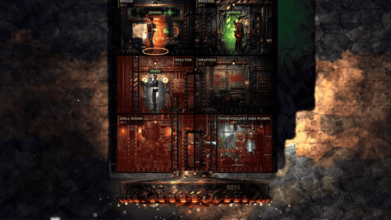
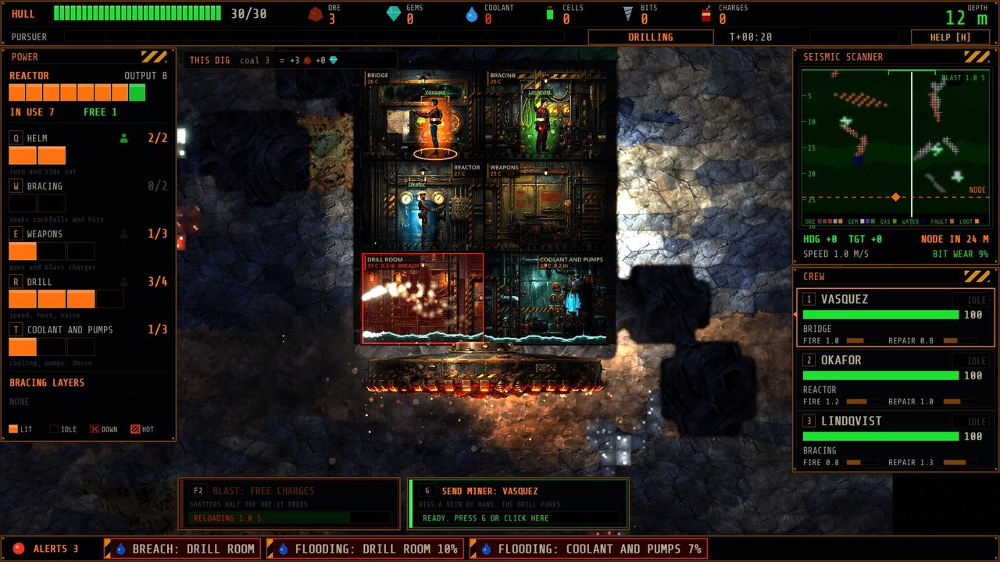
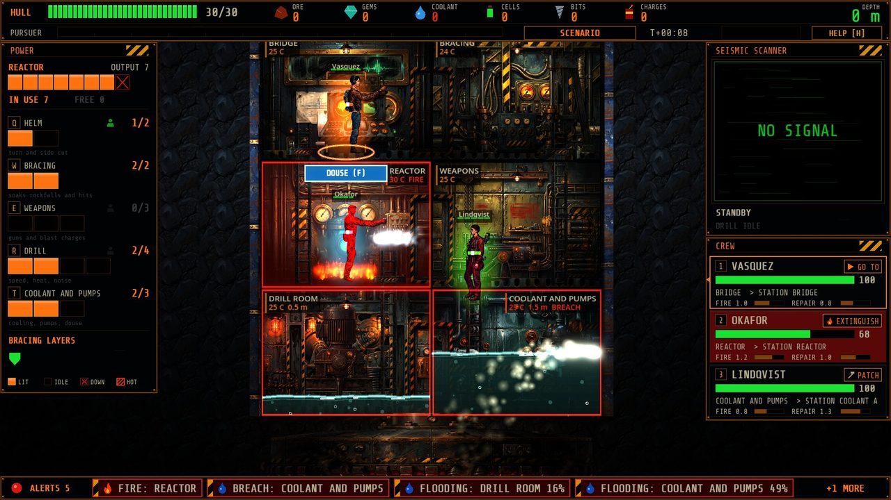
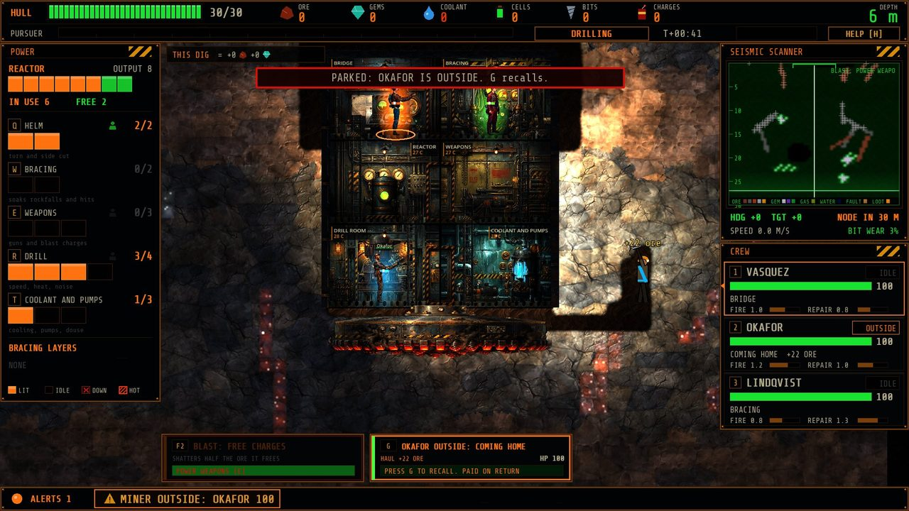
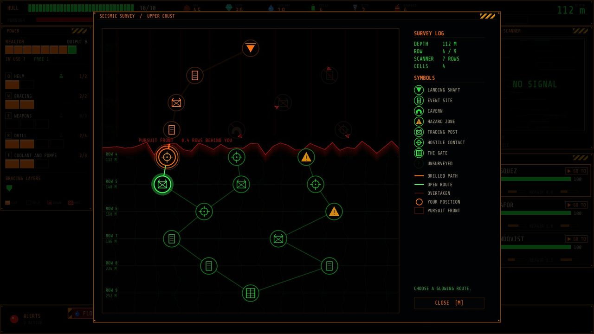

# Inner Sun


An FTL-style roguelite: a drill ship bores down through a hollow Earth toward the place where the saucers are built.



**[Landing page](https://inner-sun.pages.dev)** · **[Making-of log](docs/making-of/README.md)**

## What it is

You command the crew of **Auger**, a near-future black-budget drilling tower, in a 2D side-view cutaway. Split the reactor's power between helm, bracing, weapons, drill and coolant; keep the heat down, put out fires and pump out floods; steer the crown onto veins of ore and gems, blast through shells and gas pockets, or park and send a crew member into the rock to dig a vein by hand. Each run is one descent down a node map of the Crust, with redacted field-dossier events, trading posts, buried structures, rival drill crews and something that follows the noise you make. Real history (Byrd, the Kola borehole, Project Mohole) turns up only as lore you discover. It is a working title, in development: milestone 1, "find the fun", iterates on weekly playtests.

## Screenshots

| | |
|---|---|
|  |  |
|  |  |

## How it was made

Godot 4.7.2 (Forward+), strictly typed GDScript, built almost entirely by Claude working autonomously, with Stewart pitching, playing every build and writing the notes that steer it.

- **One deterministic simulation.** The rules live in `game/sim/` as plain classes with no rendering and no clock. The game, 368 headless tests and balance runs all push commands into the same sim at a fixed 60 Hz, so a seed plus the command log replays any run, and headless, Movie Maker and exported runs must end on the same hash.
- **Bots and a blind critic.** Three policy bots play about 1,000 full runs in twelve minutes to tune the Crust. Each build is filmed off-screen with Godot's Movie Maker while a bot plays and judged blind, first by a Claude critic on frames, later by Gemini watching the video (scores went 3.8, 5.8, 6.1, 5.6, 6.8, 4.5, 6.1, 5.6, 5.0).
- **Content is data.** Ships, rooms, weapons, crew, events, layers, codex and radio lines live in `game/data/**/*.json`, checked by a data lint.

The whole journey, with pictures, clips and every turn Stewart's playtests caused, is in [docs/making-of](docs/making-of/README.md) and [docs/progress](docs/progress/INDEX.md).

## Run it locally

Windows, with Godot 4.7.2 and Python 3 (Pillow, NumPy) on the path:

```powershell
winget install GodotEngine.GodotEngine; git clone https://github.com/Samizdat-Publications/inner-sun.git; cd inner-sun; godot --path game
```

`python tools/check.py` runs the import, the tests and the self-test (it must print `check: ok`). The other everyday tools are listed in [CLAUDE.md](CLAUDE.md).

## Credits

| What | Who | Licence |
|---|---|---|
| Painted rooms, props, crew and rock | Generated for this project with Google Gemini (prompts in `pipeline/manifests/`) | Project-owned, MIT |
| Blender sprites (art bake-off) | Made for this project in Blender by script | Project-owned, MIT |
| Placeholder sound effects | Generated for this project with ElevenLabs (prompts in `pipeline/manifests/audio.json`) | Project-owned, MIT |
| Share Tech Mono | Ralph du Carrois, [google/fonts](https://github.com/google/fonts/tree/main/ofl/sharetechmono) | SIL OFL 1.1 |
| Special Elite | Astigmatic, [google/fonts](https://github.com/google/fonts/tree/main/apache/specialelite) | Apache 2.0 |
| Godot Engine | Godot Engine contributors | MIT |

Full list: [docs/CREDITS.md](docs/CREDITS.md).

## Licence

Code is MIT (see [LICENSE](LICENSE)). Third-party assets listed above keep their own licences.

## How to play (one page)

The current playtest build is a Windows export (`builds/InnerSun.exe`, not in git); from a clone, run the project with Godot as above.

You command the drill tower **Auger**, boring down through the Crust toward the layer gate. Each run
is one descent. Dying is normal: what you learn goes into the codex and lifts redactions next time.

- **The map.** Between stops the node map opens. Click one of the lit nodes below you to drill there
  (it costs one power cell). Icons show what is there: event, cavern (salvage), hazard, store, fight,
  the gate, and the rich deposit (a gem icon: a known rich seam). Nodes inside your scanner range show
  what the rock on the way to them holds: gold pips for richness, coloured squares for the ores, diamonds
  for the gems, a yellow flame for gas pockets and a blue drop for water pockets (hover a node for it in
  words). Nodes past your scanner show as "?". The dark front creeping down from the top is the
  thing that follows your noise: nodes it swallows are lost, and if it reaches you it strikes the hull.
  Press **M** to open or close the map. Time stands still while the map is open; you can still give
  orders from it.
- **Drilling.** **A** and **D** (or the arrow keys) turn the drill 15 degrees a press (hold to keep
  turning), **S** points it straight down again, and **Shift+A** or **Shift+D** holds depth: the tower
  cuts sideways along a vein. You can also click on the seismic scanner (top right), which shows the
  rock ahead: ore veins, gem pockets, hard rock, water pockets, fault rock and buried structures. More
  drill power is faster, hotter and louder; more helm power (with someone at the bridge) turns faster
  and cuts sideways faster. Detour for ore and gems, or go straight and stay ahead of the front. A worn bit slows you down: press **B** (or click the button on the scanner) to fit a new one.
  The scanner colours each ore and gem as the rock does (a legend runs along its foot); gas pockets are
  yellow-green and water pockets blue. Whatever the crown cuts floats up as "+2 IRON", "+5 EMERALD"
  (bigger for gold and gems), a line at the top of the world shows the dig so far, and a plaque sums
  up the segment on arrival. The mouse wheel zooms the drilling view.
- **Blast.** While drilling, the charge launcher's weapon key (**F2** on the starting ship) or the BLAST
  card at the bottom left arms it;
  click the rock (in the view or on the scanner, up to 14 m away) to blast it. It needs a bar in
  weapons and costs a charge. A blast cracks hard shells, burns off gas pockets and drains water
  pockets before you reach them, but shatters half the ore it frees: cutting a vein yourself pays all
  of it.
- **Away miner.** While drilling, **G** (or the SEND MINER card next to the blast card) arms the order for
  the crew member selected on the crew cards (1 to 3); click the rock or the scanner within 12 m of the
  drill head to send them. They climb out and dig a tunnel by hand to the spot, mine out the vein there
  at full yield and walk home. The drill parks until they are back, and the front keeps coming. They are
  not aboard to man stations or fight fires, and gas, water and fault rock hurt them. What they carry
  pays only when they climb back in, and is lost if they die. **G** again recalls them; **Esc** or a
  right click cancels the aim.
- **Fault rock.** Pale cracked rock drops rockfalls on the top deck while you cut it. Each bracing
  layer (two bars in **W**) soaks one; without one you lose hull and a top room is damaged.
- **Buried structures.** Old mine works, a Soviet rig module, a crystal hollow: break in for crates of
  loot, a codex entry, sometimes an event or a trader. The map shows which routes pass one.
- **Power.** The panel on the left splits the reactor's bars between systems. Click a bar, or press
  **Q W E R T** to add a bar to helm, bracing, weapons, drill, coolant (hold **Shift** to remove
  one). Damaged bars are crossed out; overheated systems stop working. Power comes back by itself
  after a repair.
- **Heat, fire, water.** Deeper rock is hotter. Coolant keeps rooms survivable and is used up as it
  works (buy more in stores). Fires spread and water pools in the bottom deck: the crew handle
  emergencies on their own when idle. **F** (or the DOUSE button on a burning room) vents one unit of
  coolant onto the worst fire; it needs a bar in coolant and pumps.
- **Crew.** Press **1**, **2**, **3** (or click a crew card) to select someone, left-click a room to
  send them there, right-click to let them go back to their own judgement. Someone at the bridge makes
  the ship harder to hit and steer faster.
- **Pause.** **Space** pauses and unpauses. You can give orders while paused (power changes show as
  blinking bars until time moves). The game also pauses by itself when a fight starts.
- **Help.** **H** (or the HELP chip at the top right) opens the help page, which it also does on your
  very first run. **Esc** or **H** closes it.
- **Hints.** The first time a verb would pay off (power, steering, blast, the miner, douse, pause and
  so on) TOPSIDE says so on the radio strip and the control glows; each hint shows once ever.
- **Events.** Read the dossier and click an option (or press its number). Greyed options say what
  they need: the power keys still work while a dossier is open, so you can give it the bars it asks for.
- **Store.** Every line shows its price with the ore or gem icon it is paid in (red when you are short).
  Ore buys refits, hull repairs and gear (drill heads, hull plating, pumps; a line says what the gear
  changes and what it replaces); gems buy coolant, cells, bits, charges, a weapon or a new crew member. **Esc** leaves.
- **Fights.** When a rival rig attacks, its tower appears beside yours. Put power into weapons
  (**E**) and bracing (**W**), take some from the drill (**Shift+R**). Press **F1** or **F2** (or click a
  weapon card at the bottom) to arm a weapon, then click an enemy room to aim it: it fires by itself
  whenever it is charged. Bracing stops borer rounds; mining charges ignore bracing but use ammo.
  Right-click a card to stop firing. **FLEE** digs you out (it needs 2 drill bars and someone at the
  bridge).
- **The end.** The report shows how deep you got, what killed you and what you learned, and the
  research the run earned. **Requisitions** (**R**) spends research on equipment loaded onto every later
  dive (spare bits, charges, coolant, plating, a tungsten head, a fourth crew member). **New run**
  starts again.

Every run you play is saved for bug hunting in `%APPDATA%\InnerSun\runs\` (paste that into the

## Where to look

| File | What it is |
|---|---|
| `PROGRESS.md` | Current milestone, what is done, what is next |
| `PLAN.md` | The approved plan: design, decisions, milestones, content roadmap, risks |
| `HANDOFF.md` | How a fresh Claude session picks up the work (delegation, tools, gotchas) |
| `CLAUDE.md` | The project's hard rules and everyday commands |
| `docs/STEWART_FEEDBACK.md` | Playtest notes and decisions; they outrank everything else |
| `docs/DECISIONS.md` | Every design and technical decision, why, and how to revert it |
| `docs/making-of/` | The making-of timeline, milestone clips and stills |
| `docs/progress/` | Progress pictures, in order |
| `docs/research/godot-loop.md` | The Milestone 0 proof of the autonomous loop, with evidence |
| `docs/SPEND.md` | Every paid AI generation and its cost |
| `site/` | The landing page (deployed to Cloudflare Pages) |
